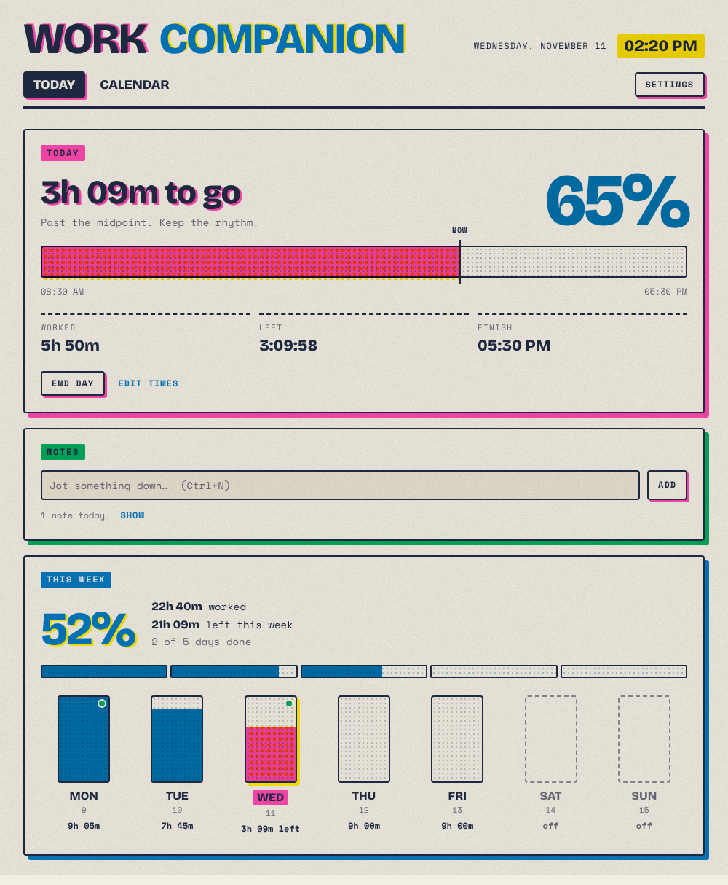
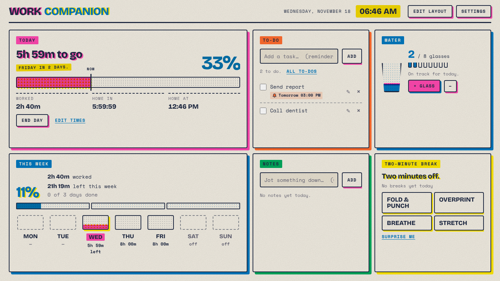

# Work Companion

A small companion for the work day, in a risograph print style.
It runs as a **web app you install from the browser** (works offline, no installer).
It is meant to grow one feature at a time and look finished at every stage.



> **For future work on this project (people or AI):** read this whole file first.
> It describes how the app is put together and the rules that keep it consistent.
> When you change the app, update this file in the same change (see *Keeping this file current*).

---

## What it does today (v0.7)

| Tab | Card | What it shows |
|---|---|---|
| **Today** | **Today** | Press **Begin day** to start the countdown to **home time** (default 9h at work). Shows time to go, % done, a progress bar, and Worked / Home in / Home at. **Worked** counts 8h for a full day (9h minus the unpaid break). **End day** logs the finish. **Resume** undoes it. A riso **ink stamp** lands at Halfway, Home time and Day done, and a line counts down to the end of the week ("Friday in 2 days"). |
| | **To-do** | A short preview: open to-dos (due reminders first, max 5), quick add, tick / edit / delete, "Show done" for today's ticked ones, link to the To-do tab. **Open to-dos always belong to today** until ticked. |
| | **Notes** | Type a note and press Enter (or `Ctrl+N` from anywhere). It is timestamped and saved to today's record. Notes stay hidden, with a "Show" toggle. Each note can be **edited** (pencil) or deleted (×). Write `#tags` in a note; click a tag to open the Notes tab filtered by it. |
| | **This week** | Week % done, hours worked/left, a bar per day. Click a day to open it in the Calendar. A green dot means that day has notes. |
| **Calendar** | **Calendar** | Month grid with hours worked, note counts and day-type tags. Select a day to fix its start/end times (for example if you forgot to press Begin day), set its **day type** (public holiday, vacation, sick day, half day), optionally through a later date to mark a whole vacation week, and manage its notes. Its **To-dos** section shows reminders set for that day and to-dos ticked that day; adding one on a future day creates a reminder for that morning. Cells show a **bell** for reminders and **✓n** for to-dos ticked that day. |
| | **Timesheet** | Hours for this week / last week / this month / last month as a table, with a total. **Copy summary** (plain text) and **Download CSV**, each optionally with notes. |
| **To-do** | **All to-dos** | Add a to-do with an optional reminder (date and/or time). Filters: Open, Reminders, Done (history grouped by the day ticked, links to the Calendar). Each row shows **Added …** and **Done …** times and the reminder. Option to allow Windows notifications. |
| *(anywhere)* | **Reminder pop-ups** | When a reminder is due a pop-up appears bottom-right: Done, Snooze 10 min, Open. Also a Windows notification if allowed. Works while the app is open; missed reminders pop when it opens next. |
| **Notes** | **Search notes** | Search all notes (matches are highlighted), filter by `#tag` chips, edit or delete in place, click a day to open it in the Calendar. |
| *(drawer)* | **Settings** | Time at work (default 9h), unpaid break (default 1h), workdays, **Layout** (Tabs or Widget board), and **Your data**: save to a file on this PC (automatic), plus manual backup / restore. |
| *(optional)* | **Widget board** | Settings → Layout → **Widget board** puts every card on one free 12-column grid instead of tabs, with a compact masthead, made for a small monitor kept open all day. **Edit layout** (masthead): drag a card to move it, drag its corner to resize it, **×** takes it off the board, **Add widget** puts it back, **Reset** restores the starting layout. Keyboard: focus a card's handle, arrows move, Shift + arrows resize, Esc finishes. Cards push others down when they would overlap; gaps you leave stay. A card with more content than fits scrolls inside and shows a halftone edge at the bottom. Links that open a tab (Week → a day, `Ctrl+2`, a `#tag`) scroll to that widget, or offer to add it if it's not on the board. Under ~700px wide the board stacks the cards in reading order. Switch back to **Tabs** any time; the board is kept for next time. |
| *(masthead)* | **Reconnect file** | Appears after a browser restart when a linked file needs the browser's permission again (one click). |
| *(masthead)* | **Install app** | Appears when the browser can install it as a desktop app (Chrome / Edge). |

Keyboard: `Ctrl+1` Today, `Ctrl+2` Calendar, `Ctrl+3` Notes, `Ctrl+4` To-do (on the widget board: scroll to that widget), `Ctrl+N` new note, `Esc` close Settings / finish Edit layout.



## Run it

### Main way: web app (GitHub Pages)

Why: Windows **Smart App Control** on the work laptop blocks unsigned desktop apps, and code signing
costs money. A web app needs no installing, so nothing gets blocked.

- Every push to `main` publishes the `src/` folder to GitHub Pages (`.github/workflows/pages.yml`).
- One-time setup: repo **Settings → Pages → Source: GitHub Actions**. Free GitHub Pages needs a **public** repo.
  That's fine: only the code is public. Your log never leaves your browser.
- Open the site in Edge or Chrome, then **Install app** (in the app's header, or the install icon in the address bar).
  It then opens in its own window, with its own icon in the Start menu and taskbar.
- Updates: push to `main`. The app picks up new files the next time it's opened while online.

### Locally

Serve `src/` with any static server and open it, e.g. `cd src && python3 -m http.server 8000` → http://localhost:8000.
ES modules don't load from `file://`, so double-clicking `index.html` won't work.

### Optional: Electron desktop build

Still works on machines without Smart App Control: `npm install` then `npm start`.
An installer (`npm install --save-dev electron-builder`, `npm run dist`) would need code signing to pass Smart App Control.

### Where data lives

| Running as | Saved in |
|---|---|
| Web app | The browser's localStorage for the site (per browser profile). Persistent storage is requested. |
| Web app + linked file | The same, **plus** a real `.json` file the user chose (Settings → Your data → Choose file…). Every change is written to it automatically. |
| Electron | `companion.json` in the OS user-data folder |

**Linked file (v0.4)** uses the browser File System Access API, so it needs Edge or Chrome. How it behaves:
- The browser remembers the file (the handle is kept in IndexedDB) but asks for permission again after a restart. The app shows **Reconnect file**; one click and saving resumes. Until then changes are still saved in the browser, and the newer copy is written to the file on reconnect.
- At startup, if the file is linked and permitted, the **most recently saved copy wins**, judged by `_savedAt`. So a file edited or synced (for example by OneDrive) from another PC is picked up.
- Choosing a file that already holds a work log asks before replacing the browser's data. A file that holds something else is never overwritten.
- A file in a OneDrive/Documents folder gives automatic cloud backup with no extra code.

Browser data can be wiped (clearing site data, IT policies, a new laptop). Link a file and/or **Download a backup** in Settings
now and then. A backup is the whole saved JSON object, and restoring runs the normal migrations, so old backups keep working.

---

## Architecture

Plain HTML/CSS/JavaScript ES modules. **No framework and no build step.** That's on purpose: any file can be read and edited directly.
The same `src/` folder runs as a web app (main) and inside Electron (optional). Nothing loads from other servers: fonts are bundled.

```
main.js / preload.js      Optional Electron wrapper: one window + read/write of companion.json
.github/workflows/        pages.yml: publishes src/ to GitHub Pages on push to main
src/index.html            Page shell: manifest, icons, fonts, riso.css, core/app.js
src/manifest.webmanifest  Web-app install info (name, colors, icons)
src/sw.js                 Service worker: offline cache (network first, cache fallback; no file list to maintain)
src/icons/                icon.svg (source) + PNGs rendered from it
src/fonts/                Self-hosted Bricolage Grotesque + Space Mono (OFL) and fonts.css
src/styles/riso.css       Design tokens + every style (sections per module)
src/core/                 Shared framework. Modules never import these directly; they get them via ctx.
  app.js                  Boot: masthead, tabs, Settings drawer, mounts modules. Defines ctx. Switches Tabs ↔ Widget board.
  registry.js             registerView() / register() — the view & module contracts; setBoardDefaults()
  board.js                Widget board data + layout maths (positions, place/push-down, hide/show, defaults)
  board-view.js           Widget board UI: the grid, Edit layout (drag, resize, keyboard), Add widget, reveal on nav; Layout section of Settings
  store.js                Saved state (one JSON object, namespaced) + versioned migrations + backup + which copy wins (browser vs linked file)
  filesync.js             Linked file on the PC: file handle, permission, debounced writes (talks to the file only)
  settings.js             User settings (day length, workdays)
  worklog.js              Day records + ALL hour maths (dayStats, weekStats, rangeStats) + actions (times, day type, notes)
  tasks.js                To-dos: one list, not tied to days; reminders (due, snooze, makeRemind)
  reminders.js            Reminder pop-ups + system notifications; checks every 5s while the app is open
  time.js                 Date helpers and formatters (pure)
  nav.js                  Hash router: #/<view>/<param>, e.g. #/calendar/2026-11-11
  clock.js                One shared 1-second tick
  dom.js                  h('div.class', {attrs}, ...children) element builder
  settings-panel.js       Settings drawer: Work day section
  data-panel.js           Settings drawer: Your data (linked file, backup / restore)
  widgets.js              Shared UI pieces: noteItem, todoItem (editable rows), richText (#tags + highlight), tagsOf, dayLabel
  pwa.js                  Web-app plumbing: registers sw.js, Install button, persistent storage
src/modules/
  index.js                THE list of tabs and modules, in order, plus where each starts on the widget board. Turn things on/off here.
  today/  tasks/  notes/  week/    (Today tab)
  calendar/  timesheet/              (Calendar tab)
  search/                            (Notes tab)
  tasklist/                          (To-do tab)
```

### Layers (top depends on bottom, never the reverse)

```
modules/*          features: draw cards, react to data, call actions
   │  via ctx only
core/app.js        shell + ctx
core/worklog.js  core/settings.js  core/nav.js  core/clock.js
core/store.js      persistence + migrations + backup (export/import)
platform           browser localStorage (web app)  or  main.js file I/O (Electron)
```

### The core idea: one work log

Every feature that is about *a day* reads from and writes to the **work log**.
Nothing keeps its own copy of hours or notes.

```jsonc
// the saved object (localStorage key "work-companion", or companion.json in Electron)
{
  "_version": 3,
  "_lastBackup": "2026-11-11T16:20:00.000Z",  // set when a backup is downloaded
  "_savedAt": "2026-11-11T16:21:00.000Z",     // set on every save; decides which copy is newest
  "settings": { "dayLengthMin": 540, "breakMin": 60, "workdays": [true, true, true, true, true, false, false],
                "layout": "tabs" },               // "tabs" | "board" (widget board)
  "board": { "items": {                       // widget board positions, see "Widget board" below; absent = defaults
    "today": { "x": 0, "y": 0, "w": 7, "h": 9 },        // 12 columns; y / h in rows of 40px
    "timesheet": { "x": 0, "y": 29, "w": 12, "h": 10, "hidden": true }
  } },
  "worklog": {
    "2026-11-11": {
      "start": "2026-11-11T07:30:00.000Z",   // Begin day (null = not started)
      "end": null,                            // End day (null = still working)
      "notes": [{ "id": "mh2x9k3a", "t": "2026-11-11T08:05:00.000Z", "text": "Standup #meeting", "e": "2026-11-11T09:00:00.000Z" }],  // e = last edited (optional)
      "kind": "vacation"                      // optional: holiday | vacation | sick | half
    }
  },
  "tasks": [{                                // to-dos, see "To-dos and reminders" below
    "id": "mh2x9k3a", "text": "Call dentist",
    "created": "2026-11-17T13:20:00.000Z",   // when it was added
    "done": null,                             // ISO time of the LAST tick; null while open
    "remind": { "date": "2026-11-18", "time": "15:00" },  // optional; time optional (date only = 9:00)
    "reminded": "2026-11-18T14:00:00.000Z"    // the due moment already shown, so it pops once
  }],
  "mod:<id>": { }                             // a module's private data, if it needs any
}
```

- Days are keyed by local date `YYYY-MM-DD` (`time.dateKey`). Timestamps are ISO strings.
- Optional fields (`kind`) are left out when empty. A day with nothing in it (no start, notes or kind) is deleted from the log.
- Tags are not stored: they are `#words` inside note text, found with `widgets.tagsOf`.

### To-dos and reminders (`core/tasks.js`, `core/reminders.js`)

- To-dos are **one list, not stored on days**. An open to-do always belongs to *today* (shows on the Today card). A ticked to-do belongs to the day of its `done` time: that's where the Calendar and the Done history show it.
- `done` holds only the **last** tick: unticking sets it to null, ticking again stamps the new time. `created` never changes.
- Reminder: `remind.date` (+ optional `remind.time`). Date only = due at 9:00 that day (`DAY_REMINDER_TIME`). A time without a date is resolved when saved to the next time it comes round (`makeRemind`).
- `reminders.js` checks every 5 s (and at startup) for open to-dos whose due time has passed and whose `reminded` differs from that due time, shows a pop-up (+ system notification if allowed) and stores `reminded`. Editing or snoozing a reminder clears `reminded`, so it pops again at the new time. A closed web app can't be woken, so pop-ups need the app open; missed ones show on next open.
- Order of open to-dos everywhere: due reminders, then upcoming reminders, then the rest by `created` (`sortOpen`).

### Hours: time at work vs counted work

The user is at work **9h** (`settings.dayLengthMin`, Begin day → home) but only **8h** count (9h minus the unpaid break, `settings.breakMin`).
The break is **not** placed in the day. Instead:
- The **countdown, progress bar and % done** use time at work (`presenceMs`, `elapsedMs`, `leftMs`). Home time = start + 9h.
- **Worked hours and the week total** use counted work: `workedMs = elapsed × (8/9)`, so a full day at work counts exactly 8h. Past home time, extra time is added 1:1 (`overMs`).
- `targetMs` = counted work for a full day (8h). `workLeftMs` = counted work still to do. `leftMs` = wall-clock time until home.

### Day states (`worklog.dayStats(date, now)`)

All hour numbers in the UI come from this one function. Change the rules there, not in modules.

| state | meaning | counted in week total? |
|---|---|---|
| `idle` | today, a workday, not begun | yes, as a full day still to do |
| `working` | begun, before home time | yes |
| `overtime` | begun today, past home time, not ended | yes (counted work + time past home) |
| `ended` | ended, **or a past day never ended** (counted as exactly one full day: 8h) | yes |
| `planned` | future workday | yes, as a full day still to do |
| `missed` | past workday with no start | no |
| `off` | non-workday with no start (beginning one makes it count) | no |
| `leave` | holiday / vacation / sick day with no start | no |

`weekStats(now)` sums the counted days Mon–Sun: `workedMs`, `leftMs`, `pct`.
`rangeStats(from, to, now)` does the same for any date range (Timesheet): `days`, `workedMs`, `daysWorked`, `leave` counts.

### Day types (`record.kind`, `worklog.KINDS`)

| kind | effect |
|---|---|
| `holiday`, `vacation`, `sick` | with no start: state `leave`, **not counted** (no hours expected that day). If you actually begin the day, it is worked as normal. |
| `half` | halves that day's time at work, break and counted work (4.5h at work / 4h counted by default). Counts normally. |

`setKind(date, kind)` sets one day. `setKindRange(from, to, kind)` marks a run in one save: setting skips non-workdays and days already worked, clearing clears every day in range.

### Widget board (`core/board.js`, `core/board-view.js`)

- Optional layout (Settings → Layout). **Tabs** is the default and unchanged. The board shows **all** modules from all views on one grid.
- The card elements are created and mounted **once** (`app.js` keeps them in a `cards` map). Switching layout only moves them between the tab `<main>`s and `<main class="board">`, so nothing remounts and typed text survives.
- Positions: `board.items[id] = { x, y, w, h, hidden? }`, 12 columns (`COLS`), rows of `--row` (40px) + 16px gap. Min 2×2. Each card gets `--gx/--gy/--gw/--gh` and CSS places it. A module missing from the saved board uses its default from `setBoardDefaults()` in `modules/index.js`; a module with no default goes at the bottom. So **a new module just appears** on existing boards.
- `board.place(items, id, next)` moves/resizes one card and pushes overlapped cards straight down (no auto-compacting, so deliberate gaps stay). Dragging previews live and saves on release.
- Navigation in board mode: `nav.onChange` calls `reveal(view)`: if none of that view's widgets is on screen it scrolls to the first and flashes it; if they're all hidden it shows a toast offering to add the first one.
- Cards on the board have a fixed height: content scrolls inside `.card-body` and `.is-clipped` adds a halftone edge when there is more below. Cards are CSS **containers**, so `@container` rules in `riso.css` reflow the inside (e.g. the Calendar stacks its day panel) by the card's own width.
- No migration was needed: `settings.layout` and `board` are new optional keys, and missing means default.

### Views and modules

A **view** is a tab: `registerView({ id, title })`.
A **module** is a card on a view:

```js
export default {
  id: 'focus',               // unique; also its private store namespace
  title: 'Focus',            // card label
  view: 'today',             // which tab (defaults to the first)
  ink: 'green',              // pink | blue | yellow | green | orange  (card accent)
  span: 'full',              // optional: 'wide' | 'full'
  mount(el, ctx) {           // draw into el; return a cleanup function
    const off = ctx.onTick((now) => { /* every second */ });
    return off;
  },
  settings(el, ctx) {},      // optional: own section in the Settings drawer
};
```

`ctx` (built in `core/app.js`):

| key | what |
|---|---|
| `h` | element builder: `h('button.btn', { onclick }, 'Label')` |
| `worklog` | `KINDS`, `getDay`, `dayStats`, `weekStats`, `rangeStats`, `beginDay`, `endDay`, `resumeDay`, `setTimes`, `clearTimes`, `setKind`, `setKindRange`, `addNote`, `editNote`, `deleteNote`, `allNotes` |
| `tasks` | `list`, `get`, `open`, `doneOn(date)`, `remindersOn(date)`, `dueAt`, `sortOpen`, `due`, `makeRemind`, `add(text, {remind})`, `toggle`, `edit(id, {text, remind})`, `remove`, `snooze` |
| `reminders` | `notifyState()` (unsupported / default / granted / denied), `enableNotify()` |
| `settings` | `get()`, `set(patch)`, `dayLengthMs()` (time at work), `workLengthMs()` (counted work) |
| `widgets` | `noteItem(date, note, {query})` and `todoItem(task, {compact, now})`: editable rows (pencil to edit, × to delete; the to-do editor also sets the reminder). Use them wherever notes / to-dos are listed. `remindChip(task)`, `whenLabel(date)` ("Today", "Tomorrow", "Mon, 9 Nov"), `richText(text, {query})` renders `#tags` as links and highlights a search; `tagsOf(text)`; `dayLabel(key)`. |
| `time` | `dateKey`, `fromKey`, `addDays`, `startOfWeek`, `atTime`, `toHHMM`, `fmtDuration`, `fmtTime`, `fmtDate`, `DAY_NAMES`, … |
| `nav` | `go(view, param)`, `current()`, `onChange(fn)` |
| `onTick(fn)` | called every second with `now`; returns unsubscribe |
| `onData(fn)` | called after any saved change; returns unsubscribe |
| `ns` | `get(fallback)` / `set(value)` for the module's private saved data |

A module that throws while mounting only breaks its own card.

### Module conventions

- **Any size.** On the widget board a card can be any width (2–12 columns) and any height. Lay out with flex/grid and `min-width: 0`; for layout changes by width use `@container` (the card is the container), not only `@media`. Give the module a default in `setBoardDefaults()`.
- **Build once, update in place.** Create elements in `mount`, then update text/styles on tick. Rebuild a list only when its shape changes (see the `lastKey` pattern in `week/`). Never recreate buttons or inputs every second: clicks and focus get lost.
- **Don't redraw under the user's cursor.** If a re-render would replace an input that has focus, skip it (see `calendar/`).
- **Talk to other features through data or navigation**, not by importing each other. Week opens a day with `nav.go('calendar', key)`. Notes write to the work log and the Calendar picks them up.
- **Day data goes in the work log.** A module's own preferences or state go in `ctx.ns`. Anything several modules need goes in `core/`.
- Every state needs a designed look: empty, not started, in progress, done, off, day type (leave / half day).
- **`replaceChildren(null)` writes the word "null".** When a child may be absent, build an array and `.filter(Boolean)` before spreading.
- Tests that match by CSS class can clash: several cards reuse `.note-status`, `.note-list`, `.todo-list`. Scope selectors with `.card[data-module="…"]`.

### Changing saved data safely

If the shape of saved data changes, bump `VERSION` in `core/store.js` and add a migration function. Never break someone's existing log.
History: v1 had fixed per-weekday start/end times. v2 replaced them with Begin day + day length, and kept the workday on/off flags. v3 moved to-dos out of the day records into `tasks` (created time recovered from the id, which starts with the creation time in base 36).

---

## Design system: Riso

Inspired by risograph printing: flat fluorescent inks on off-white paper, overprinting where inks overlap, halftone dots, slightly misaligned layers.
(Reference requested: typeui.sh/design-skills/riso. It couldn't be fetched when this was built, so this is the classic riso look. Align it if the reference differs.)

**Tokens** (`:root` in `riso.css`): `--paper #f3eee3`, `--ink #1f2a44`, `--pink #ff48b0`, `--blue #0078bf`, `--yellow #ffe800`, `--green #00a95c`, `--orange #ff6c2f`, `--muted`.
Fonts: **Bricolage Grotesque 800** (display, uppercase headings, numbers) + **Space Mono** (body, labels). Self-hosted in `src/fonts/`, with system fallbacks.
App icon: `src/icons/icon.svg` (pink + blue overprint with a yellow off-register ring and clock hands). Re-render the PNGs from it if it changes.

**Rules**
1. Only token colors. Inks are flat: no gradients except halftone dots.
2. Overlapping ink areas use `mix-blend-mode: multiply` so they overprint like real riso.
3. Offset shadows (`box-shadow: 6px 6px 0 <ink>`) instead of blurred shadows. Each card has one accent ink.
4. Misregistration (`--mis`, 3px) on big headlines (`.reg-text`, `.reg`) and highlight layers. Use it sparingly.
5. Halftone (`--halftone`) for empty or remaining space. Solid ink for done or filled.
6. 2px ink borders, 4px radius, dashed borders for "off/none".
7. Dark ink text on pink, yellow and green. Paper text only on blue and ink.
8. Paper grain overlays everything (`body::after`). Don't remove it.
9. Must work from ~420px wide up. Check narrow layouts.
10. Visible keyboard focus (blue outline) on everything clickable.
11. No visible scrollbars (hidden globally in `riso.css`). Scrolling still works. Keep tables and lists that scroll sideways obviously cut off at the edge so people know there is more.

**Widget board**: in Edit layout the board shows halftone paper; each card gets a grip (whole card), a size tag (`7 × 9`, ink), a × button and a resize corner in its own ink. A clipped card shows a halftone strip in its ink at the bottom. The masthead is one compact row.

**Stamps** (`.stamp` in `riso.css`): double-ring rubber stamp, rotated −8°, multiply blend, a worn-ink mask (`--stamp-wear`), and a short "thump" animation only when a milestone is reached live (not on reload). Ink: blue = Halfway, pink = Home time, ink = Day done.

Meaning of inks so far: **pink** = today / now, **blue** = done / week / timesheet, **yellow** = calendar / highlight / days off, **green** = notes and tags, **orange** = to-do.

---

## Adding or changing a feature: checklist

1. **Where does the data live?** About a day → `worklog`. A user preference → `settings`. Private to one feature → `ctx.ns`. Changing an existing shape → add a migration.
2. **Where does it show?** A card on an existing tab, a new tab (`registerView`), or a section in Settings (`settings(el, ctx)`).
3. **What else is affected?** Check every module that reads the same data (Today, Week and Calendar all use `dayStats`), keyboard shortcuts, the narrow layout, and every day state.
4. Register it in `src/modules/index.js`. Add its styles as a new section in `riso.css`, using tokens.
   Keep everything inside `src/` and same-origin (no CDNs) so it works offline and passes work-laptop policies.
   If you change `sw.js` itself, bump its `CACHE` name.
5. Update this README: the feature table, data model, ctx, changelog.

## Keeping this file current

Each change should update: *What it does today*, any architecture or data-model section it touches, and the *Changelog*.

## License

Code: MIT (`LICENSE`). Bundled fonts: SIL Open Font License, see `NOTICE.md`.

## Changelog

- **v0.7**: Optional **widget board** layout (Settings → Layout): every card on one free 12-column grid for a small always-on monitor. Edit layout to drag, resize (mouse or keyboard), hide and add widgets; reset to defaults; links scroll to (or offer to add) the right widget; stacks on narrow windows. Tabs stays the default and switching back keeps the board for later.
- **v0.6**: To-dos rebuilt: one list where open to-dos always belong to today and ticked ones to the day ticked, with **Added** and **Done** times (only the last tick counts). Optional **reminders** (date and/or time) with pop-ups, snooze and Windows notifications. New **To-do tab** (Open / Reminders / Done history). Calendar shows a bell for reminders and ✓n for to-dos done. **Ink stamps** at Halfway / Home time / Day done, and a "Friday in N days" line. Data migration v2→v3.
- **v0.5.1**: Scrollbars hidden everywhere.
- **v0.5**: Day types (public holiday, vacation, sick, half day), including marking a run of days; they change the week total correctly. Daily to-do list with automatic carry-over, plus planning on future days from the Calendar. Notes tab with search and `#tag` filtering. Timesheet (week/month) with copy-as-text and CSV download. Fixed: the Calendar's day header printed "null" on days with no start time.
- **v0.4**: Notes can be edited (Today and Calendar, shared `widgets.noteItem`). Day is now "time at work" (9h, the countdown to home) with an unpaid break (1h) so a full day counts 8h worked. Optional automatic saving to a real file on the PC (File System Access API) with Reconnect, newest-copy-wins and safe handling of foreign files. Settings fields: time at work, unpaid break.
- **v0.3**: Web app is now the main way to run it, because Smart App Control blocks the unsigned Electron build. Added an install manifest, an app icon, an offline service worker, an Install app button, self-hosted fonts (no outside requests), backup download/restore in Settings, and auto-publishing to GitHub Pages.
- **v0.2**: Begin day / End day / Resume with a 9h countdown (day length is configurable). Timestamped notes saved to the day. Calendar tab with day details (notes, editable times). Tabs + hash routing. Work log replaces fixed schedule (data migration v1→v2). README is now the project reference.
- **v0.1**: Today progress (fixed hours per weekday), week overview, schedule settings, riso design system, module registry.

## Ideas / roadmap

- Several named boards (e.g. "small monitor", "laptop"); a board that fits the window height exactly
- Breaks / lunch inside the day bar
- Focus timer (pomodoro) that logs sessions to the day
- Flex-time balance (running +/- against the 8h target)
- Countdown in the window title and taskbar badge; notification at home time
- Floating mini countdown window (Document Picture-in-Picture)
- On-time streak, weekly poster, night-print theme
- Repeating reminders (every Monday, every day)
- Google Calendar meetings on the day bar
- Tray icon / always-on-top mini mode showing time left
- Edit a note's time; undo for deleted notes
- Warn when the last backup / file save is old
- End-of-day notification
