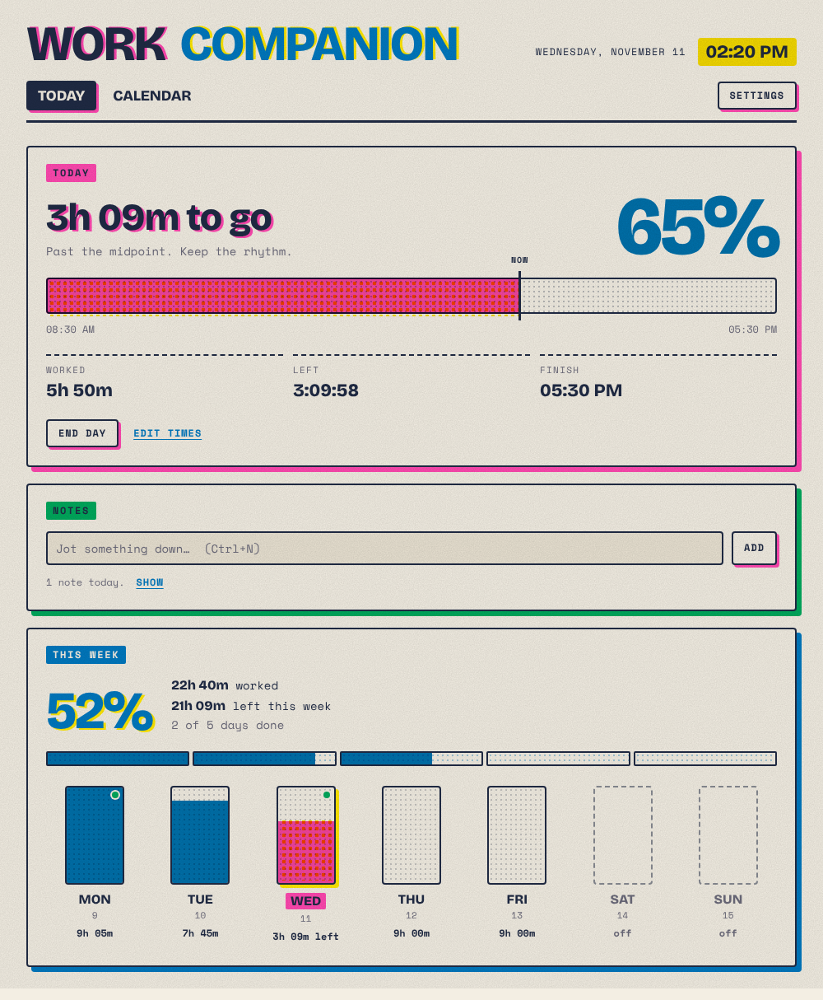

# Work Companion

A small companion for the work day, in a risograph print style.
It runs as a **web app you install from the browser** (works offline, no installer), and as a **Mac app** (`.dmg`).
It is meant to grow one feature at a time and look finished at every stage.



> **For future work on this project (people or AI):** read this whole file first.
> It describes how the app is put together and the rules that keep it consistent.
> When you change the app, update this file in the same change (see *Keeping this file current*).

---

## What it does today (v0.4)

| Tab | Card | What it shows |
|---|---|---|
| **Today** | **Today** | Press **Begin day** to start a countdown of your day length (default 9h). Shows time left, % done, a progress bar, worked/left/finish. **End day** logs the finish. **Resume** undoes it. |
| | **Notes** | Type a note and press Enter (or `Ctrl+N` from anywhere). It is timestamped and saved to today's record. Notes stay hidden, with a "Show" toggle. |
| | **This week** | Week % done, hours worked/left, a bar per day. Click a day to open it in the Calendar. A green dot means that day has notes. |
| **Calendar** | **Calendar** | Month grid with hours worked and note counts per day. Select a day to read its notes, add or delete notes, and fix its start/end times (for example if you forgot to press Begin day). |
| *(drawer)* | **Settings** | Day length in hours, which weekdays are workdays, and **Your data**: download a backup / restore one. |
| *(masthead)* | **Install app** | Appears when the browser can install it as a desktop app (Chrome / Edge). |
| *(Mac app)* | **Menu bar** | Work Companion → About, **Settings… (⌘,)**, Hide, Quit; Edit (copy/paste in note fields); View (zoom, full screen); Window. Closing the window keeps it in the Dock. |

Keyboard: `Ctrl+1` Today, `Ctrl+2` Calendar, `Ctrl+N` new note, `Ctrl+,` Settings, `Esc` close Settings.
On a Mac, `⌘` works instead of `Ctrl`, and the labels in the app show `⌘` (`core/keys.js`).

## Run it

### Main way: web app (GitHub Pages)

Why: Windows **Smart App Control** on the work laptop blocks unsigned desktop apps, and code signing
costs money. A web app needs no installing, so nothing gets blocked.

- Every push to `main` publishes the `src/` folder to GitHub Pages (`.github/workflows/pages.yml`).
- One-time setup: repo **Settings → Pages → Source: GitHub Actions**. Free GitHub Pages needs a **public** repo.
  That's fine: only the code is public. Your log never leaves your browser.
- Open the site in Edge or Chrome, then **Install app** (in the app's header, or the install icon in the address bar).
  It then opens in its own window, with its own icon in the Start menu and taskbar.
- Updates: push to `main`. The app picks up new files the next time it's opened while online.

### Locally

Serve `src/` with any static server and open it, e.g. `cd src && python3 -m http.server 8000` → http://localhost:8000.
ES modules don't load from `file://`, so double-clicking `index.html` won't work.

### Mac app

The same `src/` wrapped in Electron (`main.js`), built into a `.dmg` by GitHub Actions on a macOS machine
(`.github/workflows/mac.yml`). You don't need a Mac to build it.

- **Get it:** GitHub → **Actions → Build Mac app** → the latest run → **Artifacts → Work-Companion-mac** (a zip with the files).
  The workflow runs on every push that touches the app. For a permanent download link, push a tag
  (`git tag v0.4.0 && git push origin v0.4.0`): the files are then attached to a **GitHub Release**.
- **Which file:** `…-mac-arm64.dmg` for Apple Silicon (M1/M2/M3/M4, Apple menu → About This Mac says "Apple M…"),
  `…-mac-x64.dmg` for Intel Macs. The `.zip` files hold the same app without the disk image.
- **Install:** open the `.dmg`, drag **Work Companion** into **Applications**.
- **First open (once):** the app has no paid Apple Developer ID ($99/year), only an ad-hoc signature, so macOS blocks
  the first launch. Double-click it, press **Done** on the warning, then **System Settings → Privacy & Security**,
  scroll down to *"Work Companion" was blocked* → **Open Anyway** → enter your password. After that it opens normally.
  Or in Terminal: `xattr -dr com.apple.quarantine "/Applications/Work Companion.app"`.
- **Updates:** download the new `.dmg` and drag it into Applications again (replace). Your data stays (it's not inside the app).
- **Locally on a Mac:** `npm install`, then `npm start` to run it, or `npm run dist:mac` to build `dist/*.dmg`.

Alternative with no download at all: open the web app in **Safari → File → Add to Dock** (macOS 14+),
or install it from Chrome. It then works like an app, with its data in that browser.

### Optional: Windows / Linux Electron build

Still works on machines without Smart App Control: `npm install` then `npm start`.
A Windows installer (`npm run dist`) would need code signing to pass Smart App Control.

### Where data lives

| Running as | Saved in |
|---|---|
| Web app | The browser's localStorage for the site (per browser profile). Persistent storage is requested. |
| Mac app | `~/Library/Application Support/Work Companion/companion.json` |
| Electron (other OS) | `companion.json` in the OS user-data folder |

The web app and the Mac app keep **separate** logs. To move your log from one to the other:
Settings → **Download backup** in one, **Restore** in the other.

Browser data can be wiped (clearing site data, IT policies, a new laptop). **Download a backup** in Settings
now and then. A backup is the whole saved JSON object, and restoring runs the normal migrations, so old backups keep working.

---

## Architecture

Plain HTML/CSS/JavaScript ES modules. **No framework and no build step.** That's on purpose: any file can be read and edited directly.
The same `src/` folder runs as a web app (main) and inside Electron (the Mac app). Nothing loads from other servers: fonts are bundled.

```
main.js / preload.js      Electron wrapper (Mac app): window, native menu, read/write of companion.json
package.json              Electron + electron-builder config ("build": Mac dmg/zip, arm64 + x64)
build/                    Mac build resources: icon-mac.svg (source) → icon.png (1024), adhoc-sign.js hook
.github/workflows/        pages.yml: publishes src/ to GitHub Pages on push to main
                          mac.yml: builds the Mac .dmg/.zip on a macOS runner; Release on v* tags
src/index.html            Page shell: manifest, icons, fonts, riso.css, core/app.js
src/manifest.webmanifest  Web-app install info (name, colors, icons)
src/sw.js                 Service worker: offline cache (network first, cache fallback; no file list to maintain)
src/icons/                icon.svg (source) + PNGs rendered from it
src/fonts/                Self-hosted Bricolage Grotesque + Space Mono (OFL) and fonts.css
src/styles/riso.css       Design tokens + every style (sections per module)
src/core/                 Shared framework. Modules never import these directly; they get them via ctx.
  app.js                  Boot: masthead, tabs, Settings drawer, mounts modules. Defines ctx.
  registry.js             registerView() / register() — the view & module contracts
  store.js                Saved state (one JSON object, namespaced) + versioned migrations
  settings.js             User settings (day length, workdays)
  worklog.js              Day records + ALL hour maths (dayStats, weekStats) + actions
  time.js                 Date helpers and formatters (pure)
  nav.js                  Hash router: #/<view>/<param>, e.g. #/calendar/2026-11-11
  clock.js                One shared 1-second tick
  dom.js                  h('div.class', {attrs}, ...children) element builder
  keys.js                 Shortcut labels: ⌘ on Mac, Ctrl elsewhere
  settings-panel.js       Settings drawer: Work day section
  data-panel.js           Settings drawer: Your data (backup / restore)
  pwa.js                  Web-app plumbing: registers sw.js, Install button, persistent storage
src/modules/
  index.js                THE list of tabs and modules, in order. Turn things on/off here.
  today/  notes/  week/  calendar/
```

### Layers (top depends on bottom, never the reverse)

```
modules/*          features: draw cards, react to data, call actions
   │  via ctx only
core/app.js        shell + ctx
core/worklog.js  core/settings.js  core/nav.js  core/clock.js
core/store.js      persistence + migrations + backup (export/import)
platform           browser localStorage (web app)  or  main.js file I/O (Electron / Mac app)
```

### The core idea: one work log

Every feature that is about *a day* reads from and writes to the **work log**.
Nothing keeps its own copy of hours or notes.

```jsonc
// the saved object (localStorage key "work-companion", or companion.json in Electron)
{
  "_version": 2,
  "_lastBackup": "2026-11-11T16:20:00.000Z",  // set when a backup is downloaded
  "settings": { "dayLengthMin": 540, "workdays": [true, true, true, true, true, false, false] },
  "worklog": {
    "2026-11-11": {
      "start": "2026-11-11T07:30:00.000Z",   // Begin day (null = not started)
      "end": null,                            // End day (null = still working)
      "notes": [{ "id": "mh2x9k3a", "t": "2026-11-11T08:05:00.000Z", "text": "Standup: blocked on API keys" }]
    }
  },
  "mod:<id>": { }                             // a module's private data, if it needs any
}
```

- Days are keyed by local date `YYYY-MM-DD` (`time.dateKey`). Timestamps are ISO strings.
- An empty day (no start, no notes) is deleted from the log.

### Day states (`worklog.dayStats(date, now)`)

All hour numbers in the UI come from this one function. Change the rules there, not in modules.

| state | meaning | counted in week total? |
|---|---|---|
| `idle` | today, a workday, not begun | yes, as a full day still to do |
| `working` | begun, under the day length | yes |
| `overtime` | begun today, past day length, not ended | yes (actual time) |
| `ended` | ended, **or a past day never ended** (counted as exactly one full day) | yes (actual time) |
| `planned` | future workday | yes, as a full day still to do |
| `missed` | past workday with no start | no |
| `off` | non-workday with no start (beginning one makes it count) | no |

`weekStats(now)` sums the counted days Mon–Sun: `workedMs`, `leftMs`, `pct`.

### Views and modules

A **view** is a tab: `registerView({ id, title })`.
A **module** is a card on a view:

```js
export default {
  id: 'focus',               // unique; also its private store namespace
  title: 'Focus',            // card label
  view: 'today',             // which tab (defaults to the first)
  ink: 'green',              // pink | blue | yellow | green  (card accent)
  span: 'full',              // optional: 'wide' | 'full'
  mount(el, ctx) {           // draw into el; return a cleanup function
    const off = ctx.onTick((now) => { /* every second */ });
    return off;
  },
  settings(el, ctx) {},      // optional: own section in the Settings drawer
};
```

`ctx` (built in `core/app.js`):

| key | what |
|---|---|
| `h` | element builder: `h('button.btn', { onclick }, 'Label')` |
| `worklog` | `getDay`, `dayStats`, `weekStats`, `beginDay`, `endDay`, `resumeDay`, `setTimes`, `clearTimes`, `addNote`, `deleteNote` |
| `settings` | `get()`, `set(patch)`, `dayLengthMs()` |
| `time` | `dateKey`, `fromKey`, `addDays`, `startOfWeek`, `atTime`, `toHHMM`, `fmtDuration`, `fmtTime`, `fmtDate`, `DAY_NAMES`, … |
| `nav` | `go(view, param)`, `current()`, `onChange(fn)` |
| `keys` | `shortcut('N')` → `⌘N` on Mac, `Ctrl+N` elsewhere (for labels only); `isMac` |
| `onTick(fn)` | called every second with `now`; returns unsubscribe |
| `onData(fn)` | called after any saved change; returns unsubscribe |
| `ns` | `get(fallback)` / `set(value)` for the module's private saved data |

A module that throws while mounting only breaks its own card.

### Module conventions

- **Build once, update in place.** Create elements in `mount`, then update text/styles on tick. Rebuild a list only when its shape changes (see the `lastKey` pattern in `week/`). Never recreate buttons or inputs every second: clicks and focus get lost.
- **Don't redraw under the user's cursor.** If a re-render would replace an input that has focus, skip it (see `calendar/`).
- **Talk to other features through data or navigation**, not by importing each other. Week opens a day with `nav.go('calendar', key)`. Notes write to the work log and the Calendar picks them up.
- **Day data goes in the work log.** A module's own preferences or state go in `ctx.ns`. Anything several modules need goes in `core/`.
- Every state needs a designed look: empty, not started, in progress, done, off.

### Changing saved data safely

If the shape of saved data changes, bump `VERSION` in `core/store.js` and add a migration function. Never break someone's existing log.
History: v1 had fixed per-weekday start/end times. v2 replaced them with Begin day + day length, and kept the workday on/off flags.

---

## Design system: Riso

Inspired by risograph printing: flat fluorescent inks on off-white paper, overprinting where inks overlap, halftone dots, slightly misaligned layers.
(Reference requested: typeui.sh/design-skills/riso. It couldn't be fetched when this was built, so this is the classic riso look. Align it if the reference differs.)

**Tokens** (`:root` in `riso.css`): `--paper #f3eee3`, `--ink #1f2a44`, `--pink #ff48b0`, `--blue #0078bf`, `--yellow #ffe800`, `--green #00a95c`, `--orange #ff6c2f`, `--muted`.
Fonts: **Bricolage Grotesque 800** (display, uppercase headings, numbers) + **Space Mono** (body, labels). Self-hosted in `src/fonts/`, with system fallbacks.
App icon: `src/icons/icon.svg` (pink + blue overprint with a yellow off-register ring and clock hands). Re-render the PNGs from it if it changes.
Mac icon: `build/icon-mac.svg`, the same art on Apple's rounded-square grid with an offset ink shadow. Render it to `build/icon.png` (1024×1024, transparent) if either changes.

**Rules**
1. Only token colors. Inks are flat: no gradients except halftone dots.
2. Overlapping ink areas use `mix-blend-mode: multiply` so they overprint like real riso.
3. Offset shadows (`box-shadow: 6px 6px 0 <ink>`) instead of blurred shadows. Each card has one accent ink.
4. Misregistration (`--mis`, 3px) on big headlines (`.reg-text`, `.reg`) and highlight layers. Use it sparingly.
5. Halftone (`--halftone`) for empty or remaining space. Solid ink for done or filled.
6. 2px ink borders, 4px radius, dashed borders for "off/none".
7. Dark ink text on pink, yellow and green. Paper text only on blue and ink.
8. Paper grain overlays everything (`body::after`). Don't remove it.
9. Must work from ~420px wide up. Check narrow layouts.
10. Visible keyboard focus (blue outline) on everything clickable.

Meaning of inks so far: **pink** = today / now, **blue** = done / week, **yellow** = calendar / highlight, **green** = notes.

---

## Adding or changing a feature: checklist

1. **Where does the data live?** About a day → `worklog`. A user preference → `settings`. Private to one feature → `ctx.ns`. Changing an existing shape → add a migration.
2. **Where does it show?** A card on an existing tab, a new tab (`registerView`), or a section in Settings (`settings(el, ctx)`).
3. **What else is affected?** Check every module that reads the same data (Today, Week and Calendar all use `dayStats`), keyboard shortcuts (accept `ctrlKey || metaKey`; label with `ctx.keys.shortcut`), the narrow layout, and every day state.
   The Mac app runs the same `src/` from `file://`: don't rely on the service worker or on `https`. If a feature needs something native (menu item, notification), add it to `main.js` and a small bridge in `preload.js`.
4. Register it in `src/modules/index.js`. Add its styles as a new section in `riso.css`, using tokens.
   Keep everything inside `src/` and same-origin (no CDNs) so it works offline and passes work-laptop policies.
   If you change `sw.js` itself, bump its `CACHE` name.
5. Update this README: the feature table, data model, ctx, changelog.

## Keeping this file current

Each change should update: *What it does today*, any architecture or data-model section it touches, and the *Changelog*.

## License

Code: MIT (`LICENSE`). Bundled fonts: SIL Open Font License, see `NOTICE.md`.

## Changelog

- **v0.4**: Mac app. GitHub Actions builds a `.dmg`/`.zip` (Apple Silicon + Intel) on every relevant push, and a Release on `v*` tags. Native Mac menu with Settings… (⌘,), Edit menu for copy/paste, About panel, one window at a time, stays in the Dock when closed. Mac icon. Shortcut labels show ⌘ on Macs; `Ctrl/⌘+,` opens Settings everywhere. Safer saving of `companion.json` (write then rename).

- **v0.3**: Web app is now the main way to run it, because Smart App Control blocks the unsigned Electron build. Added an install manifest, an app icon, an offline service worker, an Install app button, self-hosted fonts (no outside requests), backup download/restore in Settings, and auto-publishing to GitHub Pages.
- **v0.2**: Begin day / End day / Resume with a 9h countdown (day length is configurable). Timestamped notes saved to the day. Calendar tab with day details (notes, editable times). Tabs + hash routing. Work log replaces fixed schedule (data migration v1→v2). README is now the project reference.
- **v0.1**: Today progress (fixed hours per weekday), week overview, schedule settings, riso design system, module registry.

## Ideas / roadmap

- Breaks / lunch inside the day bar
- Focus timer (pomodoro) that logs sessions to the day
- Daily to-do list carried over to tomorrow
- Google Calendar meetings on the day bar
- Tray / menu-bar icon (Mac app: time left in the menu bar) / always-on-top mini mode
- Export the log (CSV) and weekly summary
- End-of-day notification
